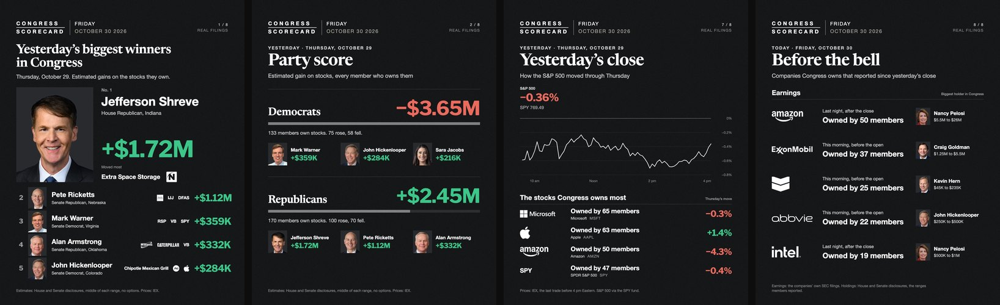

# Congress Stock Scorecard

Every morning the market is open, this builds a set of slides on how members of Congress did with their stocks the day before. Then it asks me on my phone. Nothing posts until I say so.



## The slides

1. Yesterday's biggest winners
2. Party score
3. Senate top 10
4. House top 10
5. Biggest losses
6. New trades
7. Yesterday's close (S&P 500)
8. Before the bell: companies members own that reported earnings since the close, with the biggest holder of each (only on mornings with earnings)

## A morning, by itself

| Time (Mountain) | What happens |
|---|---|
| 02:30 | Reads IEX's free historical prices for the last market day |
| 06:00 | Works out every member's estimated gain, reads the SEC's earnings filings since the close, draws the slides |
| about 06:05 | One push to my phone: every slide on one picture, with **Post it** and **No** |
| 06:30 | On Post it, the slides go out. No answer by 09:30 means nothing goes out that day |

A slide that changes after I saw it is refused. A step that may have already gone out is looked up, never sent twice. When a platform says "too many calls", it waits and checks before it tries again.

## How the numbers work

Members report what they own as ranges, like $1K to $15K. The scorecard takes the middle of each range, adds the trades they reported this year, and applies each stock's move that day. Options are left out. A move that looks like a stock split is left out. Every slide says it is an estimate.

## Where the data comes from

- **House:** the Clerk's financial disclosure filings
- **Senate:** the Senate's disclosure site, read in a browser after a person ticks its agreement box. The code never ticks it.
- **Earnings:** SEC EDGAR, 8-K filings with Item 2.02
- **Prices:** IEX Historical Data. Data provided for free by IEX. By accessing or using IEX Historical Data, you agree to the [IEX Historical Data Terms of Use](https://www.iex.io/legal/hist-data-terms).

## The code

| File | What it does |
|---|---|
| `daily.py` | The whole morning, on a two minute timer (`install`, `remove`, `status`) |
| `morning.sh` | One day's slides by hand |
| `prices.py`, `tools/iextops.c` | Streams IEX's daily TOPS file (10 to 15 GB) through a small C reader and keeps only each stock's last trade |
| `pull_trades.py` | New trade reports |
| `pull_holdings.py` | What every member owns: yearly reports plus this year's trades |
| `estimate.py` | Every member's estimated gain or loss |
| `bell.py` | Before the bell: the SEC's earnings filings since the close, and who owns each company |
| `scorecard.py` | Draws the slides in HTML, shoots them with headless Chrome, writes the caption |
| `headshots.py`, `tools/cutout.swift` | Cuts every face out the same way, with Apple's Vision framework |
| `tools/senate_read.js` | Reads the Senate's reports in the browser, after the box is ticked |
| `tests/` | 29 tests of the morning's steps, with everything outside faked |

## Not in this repo

- **Posting.** It runs through my own publishing system, which stays private for now.
- **Portraits and company logos.** The slides expect them. Put your own in `atlas/` (`registry.json` plus `img/`), or set `SCORECARD_ATLAS`.
- **Fonts.** Newsreader and Libre Franklin, both free on Google Fonts. Put the `.woff2` files in `fonts/`.

## Run it

Needs macOS, Python 3.9 or newer with Pillow and numpy, and Google Chrome.

```bash
cc -O2 -o tools/iextops tools/iextops.c
python3 -m unittest discover -s tests
./morning.sh --day 2026-10-29
```

The first run of a day streams that day's IEX file (10 to 15 GB, about 10 minutes); nothing big is kept. The Senate side needs one browser read first (`tools/senate_read.js`). The SEC asks every program for a contact: put yours in `~/.config/congress-scorecard/sec.json` as `{"contact": "you@example.com"}`.

---

All rights reserved. Shared to show my work.
